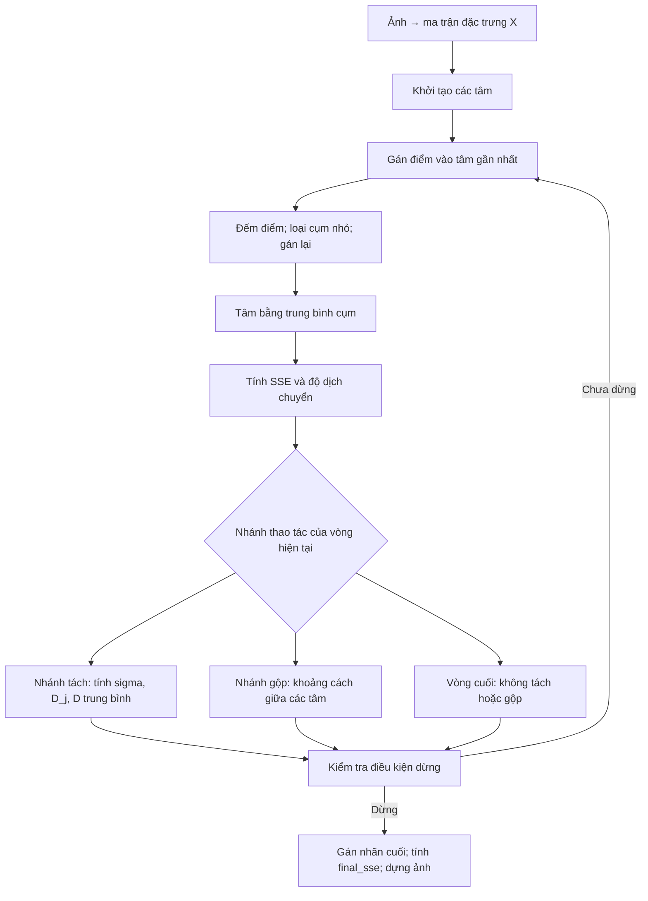

# Hiểu ISODATA từ công thức đến code

Tài liệu học cho trưởng nhóm. Các công thức dưới đây mô tả **biến thể đang cài đặt trong dự án**; không khẳng định mọi thư viện ISODATA có cùng lịch tách/gộp hoặc điều kiện dừng. Ví dụ số được kiểm tra bằng `demo_formulas.py`.

## 1. Câu chuyện xuyên suốt

Mỗi pixel là một điểm trong không gian đặc trưng. Các điểm được chia về những tâm đại diện gần nhất. Tâm dịch chuyển về trung bình các điểm được giao. Sau đó thuật toán hỏi: cụm có quá ít điểm không, có trải quá rộng không, hay hai cụm có quá giống nhau không? Câu trả lời quyết định loại, tách hoặc gộp. Các tâm mới lại làm thay đổi việc gán điểm ở vòng sau.



SSE trong code là chỉ số ghi lại để đánh giá; quyết định tách không dùng trực tiếp SSE mà dùng sigma, D_j và số điểm. Nhánh gộp dùng khoảng cách tâm.

## 2. Đọc đúng ký hiệu trước khi học công thức

| Ký hiệu | Ý nghĩa | Trong code |
|---|---|---|
| N | Tổng số pixel sau resize | `len(X)` |
| d | Số chiều đặc trưng | `X.shape[1]` |
| x_i | Vector của pixel i | `X[i]` |
| C_j | Tập pixel hiện thuộc cụm j | `X[labels == j]` |
| n_j | Số pixel trong C_j | `counts[j]` |
| mu_j | Tâm cụm j, là vector d chiều | `centers[j]` |
| K | Số cụm định hướng | `K` |
| K_0 | Số tâm khởi tạo | `init_k` |
| N_c | Số tâm tại thời điểm đang xét | `len(centers)` |

Không dùng K, K_0 và N_c thay thế nhau. Trong thực nghiệm trước, K=5, K_0=10 nhưng ảnh phong cảnh Lab kết thúc N_c=7 ở seed=0.

Ảnh RGB 200×150 có N=30.000, d=3. Một pixel có thể là x_i=(120,80,40). Các điểm gần trong không gian màu không nhất thiết nằm cạnh nhau trên ảnh. Khi thêm XY, d=5; khoảng cách có thêm phần vị trí. Cùng một cụm vẫn không được bảo đảm liên thông.

Trong `utils.image_to_features`, tọa độ được chuẩn hóa về 0..255 và nhân trọng số w. Vì khoảng cách được bình phương, phần vị trí góp hệ số w² vào khoảng cách bình phương. w=1 không bảo đảm vị trí và màu có ảnh hưởng ngang nhau trên dữ liệu thực.

## 3. Gán điểm: bắt đầu bằng khoảng cách

$$
d_{ij}=\|x_i-\mu_j\|_2=\sqrt{\sum_{r=1}^{d}(x_{ir}-\mu_{jr})^2},\qquad
\ell_i=\arg\min_j d_{ij}^2.
$$

Với các tâm đang cố định, từng pixel chọn tâm gần nhất. Căn bậc hai là hàm tăng nên dùng khoảng cách bình phương vẫn chọn cùng tâm, tiết kiệm tính toán. Nếu hòa, `argmin` chọn chỉ số đầu tiên.

Liên kết code: `kmeans.pairwise_sq_dist` → `isodata.assign`. Ma trận khoảng cách có N hàng, N_c cột. Code dùng khai triển tích vô hướng thay vì tạo mảng N×N_c×d.

## 4. Loại cụm nhỏ rồi cập nhật tâm

Nếu n_j < theta_N, bỏ tâm đó và gán lại pixel vào các tâm còn lại. Code luôn bỏ cụm rỗng, kể cả theta_N=0. Nếu mọi cụm đều nhỏ, giữ lại cụm đông nhất để không mất hết tâm.

Sau khi có nhóm điểm, tâm được tính bằng:

$$
\mu_j=\frac{1}{n_j}\sum_{x_i\in C_j}x_i.
$$

Tại sao dùng trung bình? Với nhóm điểm cố định, ta muốn giảm tổng bình phương khoảng cách đến tâm:

$$
J_j(\mu)=\sum_{x_i\in C_j}\|x_i-\mu\|^2,
\quad \nabla_\mu J_j=2n_j\mu-2\sum_{x_i\in C_j}x_i=0.
$$

Giải ra đúng trung bình. Vì vậy **gán điểm và cập nhật tâm là hai bước giảm sai số luân phiên** khi số cụm/cấu trúc được giữ cố định. Liên kết code: `discard_small` → `update_centers`.

Lưu ý: đây là kiểm tra loại cụm ở từng vòng, không phải cam kết mọi cụm đầu ra luôn có ít nhất theta_N pixel khi dừng sớm.

## 5. SSE, D_j và sigma liên quan thế nào?

### SSE: sai số bình phương toàn bộ phân hoạch

$$
J=\mathrm{SSE}=\sum_j\sum_{x_i\in C_j}\|x_i-\mu_j\|^2.
$$

SSE thấp nghĩa các pixel gần tâm hơn trong không gian đặc trưng đang dùng. Chỉ so sánh có ý nghĩa khi kiểm soát dữ liệu, thang đo và số cụm. Nếu cho mỗi điểm một tâm, SSE có thể bằng 0 nhưng không tạo ra kết quả phân cụm hữu ích.

### D_j: bán kính trung bình của một cụm

$$
D_j=\frac{1}{n_j}\sum_{x_i\in C_j}\|x_i-\mu_j\|,
\qquad \bar D=\frac{1}{N}\sum_j n_jD_j.
$$

D_j trả lời “điểm trong cụm j cách tâm trung bình bao xa?”. D trung bình toàn cục dùng trọng số n_j để mỗi pixel có đóng góp như nhau. Lấy trung bình đều các D_j sẽ làm cụm 10 điểm có trọng lượng ngang cụm 10.000 điểm.

### Sigma: độ phân tán trên từng chiều

$$
\sigma_{jr}=\sqrt{\frac{1}{n_j}\sum_{x_i\in C_j}(x_{ir}-\mu_{jr})^2}.
$$

Code dùng phương sai tổng thể, chia n_j, không chia n_j−1. Sigma là vector d chiều: nó chỉ ra chiều nào trải rộng nhất. `cluster_stats` tính tương đương bằng E[x²]−E[x]² và chặn sai số làm tròn âm về 0.

Mối liên kết quan trọng, khi mu_j đúng là trung bình của C_j:

$$
\boxed{J=\sum_j n_j\sum_{r=1}^{d}\sigma_{jr}^2}.
$$

SSE và sigma cùng xuất phát từ độ lệch quanh tâm. SSE cộng bình phương trên tất cả chiều, tất cả điểm; sigma tách riêng từng chiều để chọn hướng tách.

Nhưng:

$$
D_j\ne\sqrt{J_j/n_j}\text{ nói chung};\qquad D_j\le\sqrt{J_j/n_j}.
$$

Một bên là trung bình khoảng cách, bên kia là căn trung bình bình phương khoảng cách. Đừng tráo chúng khi giải thích điều kiện tách. Đẳng thức SSE–sigma cũng không được áp dụng máy móc ngay sau khi gán nhãn cuối nếu tâm chưa được cập nhật lại theo nhãn mới.

## 6. Tách cụm: dùng thống kê để tạo hai tâm đề xuất

Chọn chiều r* có sigma lớn nhất. Trong code, cụm được tách nếu:

$$
\sigma_{j,r^*}>\theta_S
\quad\land\quad
\big[(D_j>\bar D\land n_j>2(\theta_N+1))\lor N_c\le K/2\big]
\quad\land\quad n_j\ge2.
$$

Đọc thành lời: “Cụm phải đủ phân tán; đồng thời hoặc nó rộng hơn mức trung bình và đủ đông, hoặc tổng số cụm hiện quá ít; ít nhất phải có hai điểm.”

Nhánh N_c≤K/2 bỏ qua yêu cầu D_j> D trung bình và n_j>2(theta_N+1), nhưng không bỏ qua sigma>theta_S và n_j≥2. Đây là chỗ dễ đọc sai dấu AND/OR.

Hai tâm mới:

$$
\mu_j^{+}=\mu_j+\alpha\sigma_{j,r^*}e_{r^*},\qquad
\mu_j^{-}=\mu_j-\alpha\sigma_{j,r^*}e_{r^*}.
$$

alpha=`split_k`=0,5 mặc định; e_r* chỉ có 1 ở chiều được chọn. Tách dọc một trục đặc trưng, không phải hướng PCA. Chưa chia pixel ngay trong hàm `split_clusters`: các tâm đề xuất chỉ tạo điều kiện để vòng sau gán lại điểm rồi cập nhật trung bình.

## 7. Gộp cụm: vì sao cần trọng số?

Tính khoảng cách giữa tâm: delta_ab=||mu_a−mu_b||. Nếu nhỏ hơn theta_c, cặp được đưa vào xem xét; ưu tiên gần nhất, tối đa L cặp, mỗi tâm chỉ tham gia một cặp trong vòng đó.

$$
\mu_{ab}=\frac{n_a\mu_a+n_b\mu_b}{n_a+n_b}.
$$

Ví dụ n_a=2, mu_a=1; n_b=4, mu_b=11. Tâm gộp là 46/6≈7,667, không phải (1+11)/2=6. Công thức có trọng số chính là trung bình của toàn bộ điểm ở hai cụm.

Nếu giữ nguyên các điểm thuộc hai cụm và tâm cũ là các trung bình, mức tăng SSE do gộp là:

$$
\Delta J=\frac{n_an_b}{n_a+n_b}\|\mu_a-\mu_b\|^2\ge0.
$$

Đây là hệ quả đại số để hiểu tác động, **code không dùng Delta J làm tiêu chuẩn gộp**. Sau gộp, vòng sau còn gán lại điểm nên SSE toàn cục có thể thay đổi tiếp. Vì có thao tác gộp/loại, không yêu cầu đường SSE của toàn bộ ISODATA giảm đơn điệu như các bước Lloyd với K cố định.

## 8. Ví dụ tính tay nối toàn bộ công thức

Dữ liệu một chiều X={0,2,8,10}, ban đầu một cụm:

1. mu=(0+2+8+10)/4=5.
2. Độ lệch là −5,−3,3,5; SSE=25+9+9+25=68.
3. D_j=(5+3+3+5)/4=4; sigma=sqrt(68/4)=sqrt(17)≈4,1231.
4. Chọn K=4, theta_N=1, theta_S=3. N_c=1≤K/2 nên điều kiện tách đạt dù D_j=D trung bình.
5. Hai tâm đề xuất: 5±0,5×sqrt(17)≈2,9384 và 7,0616.
6. Gán lại: {0,2} về tâm thấp, {8,10} về tâm cao. Cập nhật trung bình thành 1 và 9. SSE=1+1+1+1=4.
7. Minh họa riêng phép gộp với theta_c=9: khoảng cách hai tâm là 8<9; tâm gộp về 5, SSE về 68. Delta J=(2×2/4)×8²=64.

Chạy để kiểm tra với chính các hàm trong dự án:

```powershell
.\venv\Scripts\python.exe demo_formulas.py
```

Đây là chuỗi gọi từng khối để học. Không trình bày nó như log của một lần chạy `isodata()` đầy đủ. Ví dụ cũng cho thấy ngưỡng tách/gộp không phù hợp có thể khuyến khích các thao tác ngược nhau.

## 9. Lịch thao tác và điều kiện dừng đúng với code

Thứ tự ưu tiên sau khi loại cụm nhỏ và cập nhật tâm:

1. Vòng cuối: bỏ tách/gộp.
2. Nếu N_c≤K/2: xét tách.
3. Nếu vòng lẻ và N_c<2K: xét tách.
4. Các trường hợp còn lại: xét gộp.

“Xét tách” không đồng nghĩa “chắc chắn tách”; phải thỏa công thức mục 6. Không bảo đảm số cụm luôn thuộc [K/2,2K], vì đây là các ngưỡng điều khiển, không phải ràng buộc cứng.

Tâm được coi ít dịch chuyển khi:

$$
\max_j\|\mu_j^{new}-\mu_j^{old}\|\le tol.
$$

Hai vòng liên tiếp ít dịch chuyển và không loại/tách/gộp thì code báo hội tụ. Vòng cuối bỏ thao tác cấu trúc nên không dùng làm bằng chứng hội tụ. Đây là điều kiện dừng thực dụng của bản cài đặt, không phải chứng minh tìm được nghiệm toàn cục. Khi chạm max_iter, vẫn trả nhãn và tâm nhưng cờ hội tụ là False.

## 10. Ánh xạ công thức với file

| Bạn giải thích | Mở hàm |
|---|---|
| Pixel thành vector | `utils.image_to_features` |
| Khoảng cách bình phương và argmin | `kmeans.pairwise_sq_dist`, `isodata.assign` |
| Loại nhóm ít điểm | `isodata.discard_small` |
| Trung bình cụm | `isodata.update_centers` |
| Sigma, D_j và D trung bình | `isodata.cluster_stats` |
| Điều kiện tách, hai tâm đề xuất | `isodata.split_clusters` |
| Khoảng cách tâm, trung bình có trọng số | `isodata.merge_clusters` |
| Lịch thao tác, dừng, final_sse | `isodata.isodata` |
| Màu đầu ra | `utils.features_to_image` |

## 11. Tự vấn đáp, trả lời bằng lý do

**Tại sao không chỉ dùng K-means?** K-means giữ số tâm cố định. Đề tài khảo sát thêm các thao tác thay đổi cấu trúc cụm để bớt phụ thuộc vào một số tâm khởi tạo, nhưng phải trả giá bằng nhiều ngưỡng và quá trình phức tạp hơn.

**ISODATA tự tìm số cụm tối ưu không?** Nó điều chỉnh số cụm theo quy tắc và tham số, không bảo đảm tối ưu hoặc đúng số đối tượng trong ảnh.

**Giảm theta_S thì K cuối có chắc tăng?** Với cùng trạng thái hiện tại, ngưỡng thấp làm điều kiện sigma dễ đạt hơn. Nhưng K cuối còn chịu gộp, loại và các vòng sau nên không có bảo đảm đơn điệu.

**Tăng theta_c thì sao?** Tại cùng trạng thái, nhiều cặp có thể đủ điều kiện gộp hơn. K cuối vẫn phụ thuộc toàn bộ diễn biến. Cần nêu đúng phạm vi số liệu quan sát.

**Vì sao cần seed?** Khởi tạo có ngẫu nhiên. Cố định seed giúp lặp lại kết quả trong cùng môi trường; thử nhiều seed cho thấy độ nhạy với khởi tạo.

**SSE giảm chứng minh ảnh tốt hơn chưa?** Chưa. Cần cùng ảnh/đặc trưng và xem xét K. SSE đo độ gần tâm, không đo độ đúng ngữ nghĩa của cây, trời, mặt nước.

**Có nhận ra vật thể không?** Chưa. Kết quả là nhóm pixel theo đặc trưng, không tự gán tên đối tượng. Cùng màu ở xa nhau vẫn có thể chung nhãn.

**Có phải mọi cụm nhỏ là nhiễu?** Không; có thể là chi tiết nhỏ có ích. theta_N quá lớn có thể làm mất nhóm chi tiết đó bằng cách gán nó vào cụm khác.

**Tại sao dùng Lab?** Là một lựa chọn biểu diễn màu khác RGB để khảo sát. Bản này dùng Lab 8-bit của OpenCV; không khẳng định Euclid trên mã hóa này chính là Delta E chuẩn hoặc Lab luôn tốt hơn.

**Độ phức tạp?** Bước gán khoảng O(N N_c d) mỗi vòng và ma trận khoảng cách chiếm O(N N_c) bộ nhớ; so sánh các tâm để gộp khoảng O(N_c² d), còn có sắp xếp cặp. N_c thay đổi nên thời gian không chỉ phụ thuộc số vòng. Resize giảm N nhưng có thể mất chi tiết.

**Đã chứng minh thuật toán đúng chưa?** Đã kiểm tra những tình huống cụ thể và công thức trong ví dụ; chưa phải chứng minh mọi đầu vào. Cần thêm dữ liệu và khảo sát.

**Đã làm gì mới cho lần báo cáo này?** Có khảo sát một ảnh với 7 cấu hình × 3 seed và demo tính tay được kiểm chứng bằng code. Đây là nâng cấp phần giải thích và đánh giá, không phải đề xuất thuật toán mới.

## 12. Nguồn đối chiếu và phạm vi sử dụng

- [CATALYST — ISOCLUS](https://catalyst.earth/catalyst-system-files/professional-help/references/pciFunction_r/easi/E_isoclus.html): tài liệu nhà phát triển mô tả các bước và điều kiện tách/gộp. Dự án không sao chép toàn bộ hành vi sản phẩm; khởi tạo, xử lý cụm nhỏ và dừng cần đọc theo code.
- [MathWorks — imsegisodata](https://www.mathworks.com/help/images/ref/imsegisodata.html): đối chiếu ý nghĩa tham số và các cơ chế chính; không dùng để khẳng định kết quả NumPy tương đương MATLAB.

Các phép suy ra trung bình tối thiểu hóa SSE, liên hệ SSE–sigma, mức tăng SSE khi gộp và ví dụ số ở đây được trình bày từ công thức và mã dự án, không trích nguyên văn nguồn. Khi viết báo cáo, chọn tài liệu thuật toán giảng viên sử dụng và ghi rõ những khác biệt của bản cài đặt.
