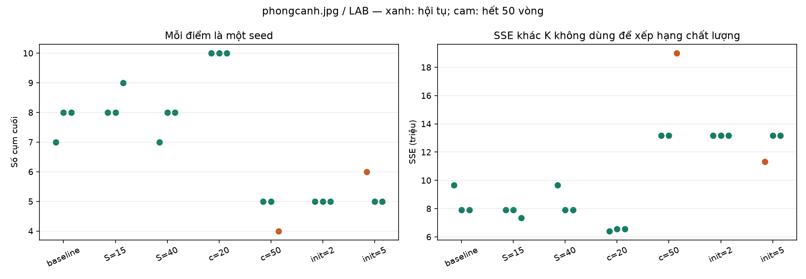

# Khảo sát độ nhạy tham số

Ảnh `images/phongcanh.jpg`, LAB, 30000 pixel, seeds=[0, 1, 2].
Cấu hình cơ sở: `{'K': 5, 'init_k': 10, 'theta_N': 60, 'theta_S': 25.0, 'theta_c': 30.0, 'L': 2, 'max_iter': 50, 'tol': 0.1}`. Mỗi hàng chỉ thay tham số ghi trong tên cấu hình.
K liệt kê theo thứ tự seed. SD là độ lệch chuẩn mẫu của SSE (ddof=1), không phải độ lệch chuẩn pixel dùng để tách.
Tổng hợp cả lần chưa hội tụ. Không dùng SSE để xếp hạng các hàng khác K; chưa khảo sát tương tác tham số hoặc toàn bộ bộ ảnh.

| Cấu hình | K cuối theo seed | SSE trung bình | SD SSE | Hội tụ |
|---|---|---:|---:|---:|
| baseline | [7, 8, 8] | 8490979 | 1002146 | 3/3 |
| S=15 | [8, 8, 9] | 7720573 | 332254 | 3/3 |
| S=40 | [7, 8, 8] | 8490979 | 1002146 | 3/3 |
| c=20 | [10, 10, 10] | 6513355 | 84539 | 3/3 |
| c=50 | [5, 5, 4] | 15120834 | 3360233 | 2/3 |
| init=2 | [5, 5, 5] | 13180724 | 83 | 3/3 |
| init=5 | [6, 5, 5] | 12556501 | 1081225 | 2/3 |

Đọc cùng `experiment.json` để xem cấu hình và sự kiện từng vòng. Đây là khảo sát mô tả, không phải tìm bộ tham số tối ưu.
